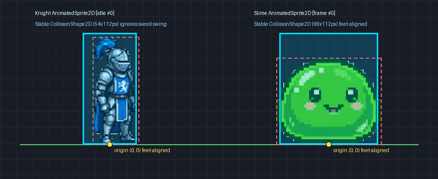
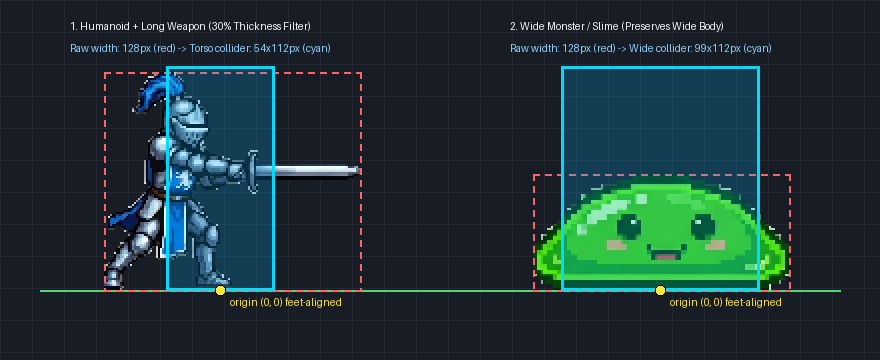

# godot-sprite-mcp

**[English](README.md) | [简体中文](README_zh.md)**

一个专为 **Godot 4.x** 打造的轻量级 **MCP (Model Context Protocol) 工具服务与命令行工具**。
无需打开 Godot 编辑器、无需安装笨重的 OpenCV，直接从 PNG 精灵图的 Alpha 透明通道自动识别切帧、导出 Godot 4 `SpriteFrames (.tres)` 动画资源，并自动计算**脚底对齐、自动滤除长柄武器**的角色身体碰撞框（`CollisionShape2D`）。





## ✨ 核心功能

| MCP 工具名 | 功能说明 |
| :--- | :--- |
| **`inspect_spritesheet`** | 分析 PNG 透明通道，自动识别规则网格（Grid）或不规则排布的独立精灵帧（Islands）坐标。 |
| **`build_sprite_frames`** | 根据切帧结果，直接生成符合 Godot 4 (`format=3`) 规范的 `SpriteFrames` `.tres` 动画资源文件。 |
| **`build_body_collider`** | 叠加动画序列帧并通过 **30% 竖向厚度过滤算法**，自动生成脚底对齐 `(0, 0)` 原点的稳定 `RectangleShape2D` / `CapsuleShape2D` 角色碰撞框（自动削掉挥出的细薄长剑，同时完整保留史莱姆等扁宽怪物的宽身体）。 |
| **`extract_collision_polygon`** | 提取像素外轮廓并进行多边形抽稀简化，为石头、箱子等静态物体生成 `CollisionPolygon2D`。 |

---

## 🚀 快速接入（如何作为 AI 插件使用？）

你不需要在 Godot 工程里安装任何插件，只需将本工具添加到你的 AI 编程助手（如 **Cursor、Claude Code、Windsurf、Cline、Codex** 等）的 MCP 配置文件（`mcp.json`）中即可：

### 方式一：通过 `uvx` 免安装直接运行（推荐，需仓库公开或已授权 GitHub）

```json
{
  "mcpServers": {
    "godot-sprite": {
      "command": "uvx",
      "args": [
        "--from",
        "git+https://github.com/huha007/godot-sprite-mcp",
        "godot-sprite-mcp"
      ]
    }
  }
}
```

### 方式二：克隆到本地运行

```bash
git clone https://github.com/huha007/godot-sprite-mcp.git
cd godot-sprite-mcp
pip install -e .
```

然后在 AI 客户端的 `mcp.json` 中填入：

```json
{
  "mcpServers": {
    "godot-sprite": {
      "command": "godot-sprite-mcp"
    }
  }
}
```

---

## 💬 接入后怎么用？（直接在聊天框对 AI 说人话）

配置完成后，你的 AI 助手就自动学会了上述 4 个技能。打开你的 Godot 项目，直接用自然语言吩咐 AI：

- *“帮我看看 `res://assets/knight_sheet.png` 里有几帧？把第一行做成 `idle`、第二行做成 `run`、第三行做成 `attack` 导出成 `.tres` 动画，并帮我生成一个带脚底对齐身体碰撞框的 `Knight.tscn` 场景。”*
- *“分析一下 `res://assets/slime.png`，给这只史莱姆生成动画资源和合适宽度的身体碰撞体。”*

---

## 🛠️ 命令行独立使用（CLI 模式）

即使不配合 AI，你也可以在终端或 CI/CD 流水线中直接把它当成命令行工具使用：

```bash
# 1. 自动识别精灵图切帧坐标
godot-sprite-mcp inspect assets/knight_sheet.png --mode auto

# 2. 生成 Godot 4 SpriteFrames (.tres) 动画资源
godot-sprite-mcp build \
  --project-root . \
  --image assets/knight_sheet.png \
  --animations @animations.json \
  --output res://resources/knight_frames.tres

# 3. 计算脚底对齐的稳定角色身体碰撞框
godot-sprite-mcp body-collision assets/knight_sheet.png \
  --frames @idle_frames.json \
  --shape rectangle \
  --thickness-ratio 0.30

# 4. 为静态障碍物提取紧贴轮廓的多边形碰撞
godot-sprite-mcp collision assets/rock.png --epsilon 2.0
```

## 🧪 运行单元测试

```bash
pip install -e ".[dev]"
pytest
```

## 📄 开源协议

[MIT](LICENSE)
